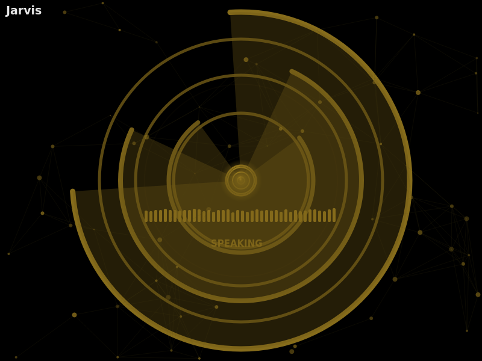
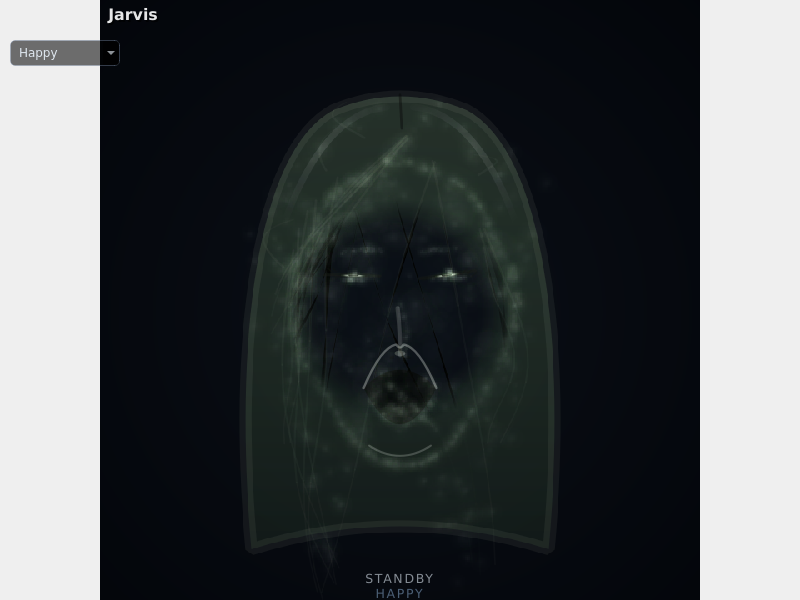
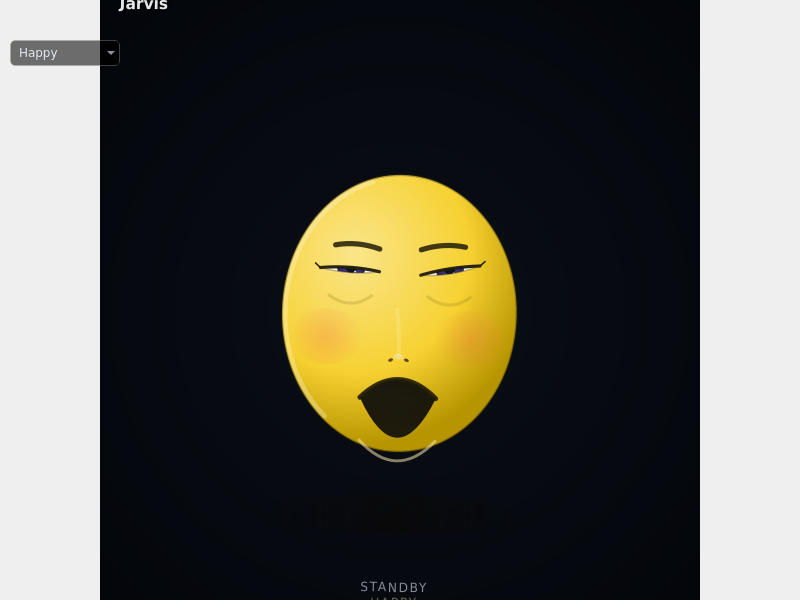
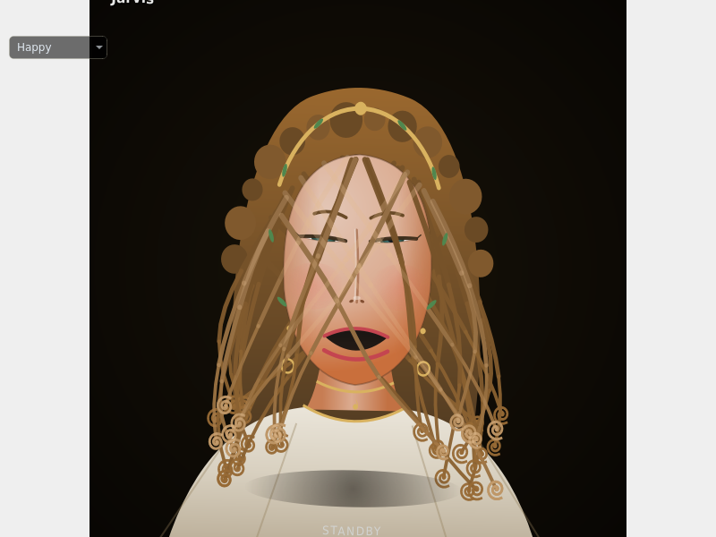
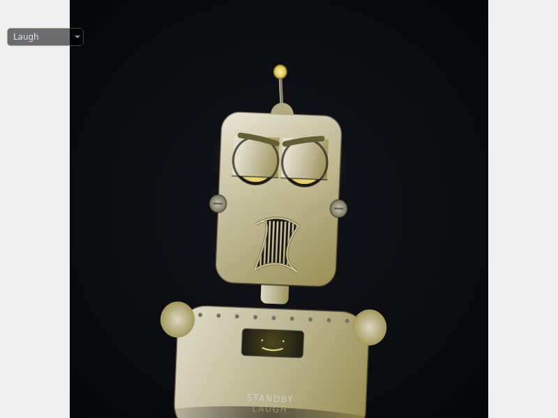
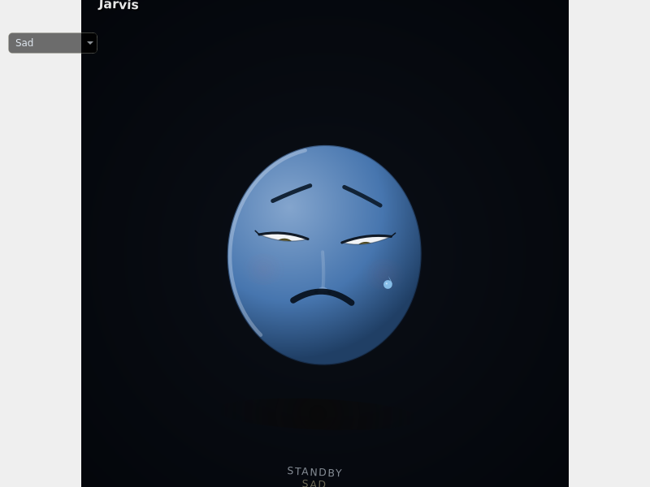
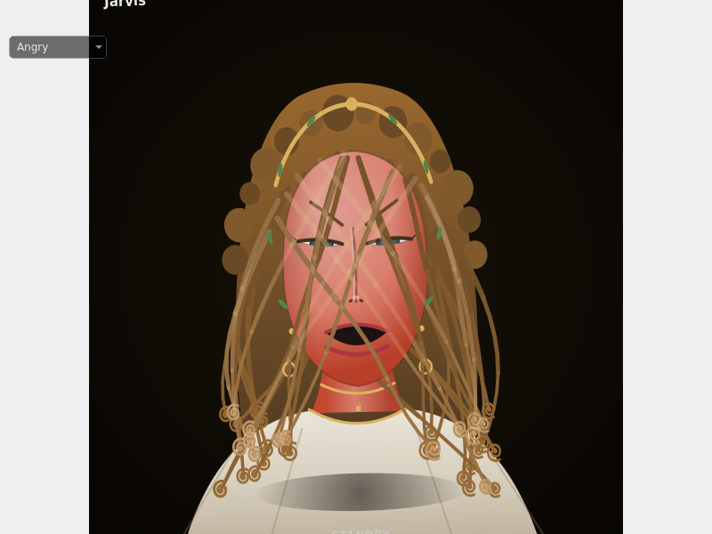
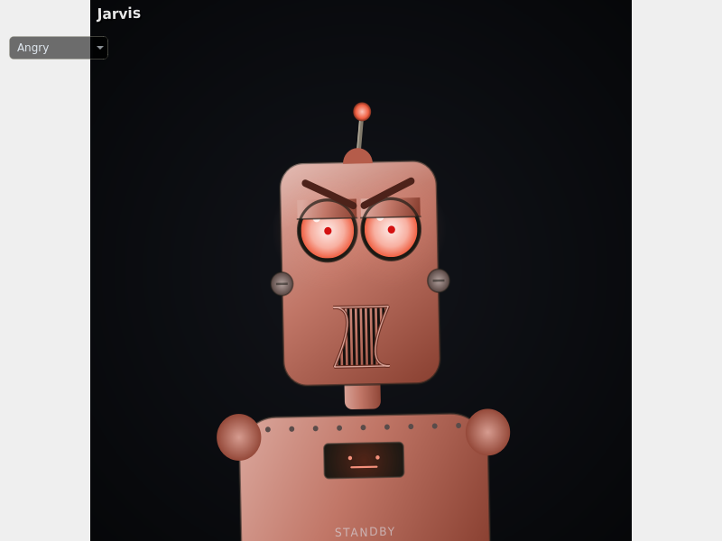

# Jarvis Desktop

PyQt6 Arc Reactor HUD with voice interaction.

## Stack

- **HUD**: switchable frontends — Arc Reactor, Smoke Face, or three solid emotive avatars (Smiley / Goddess / Robot); mouth lip-syncs to TTS PCM, emotion set by LLM `[emo:x]` tags
- **STT**: Faster-whisper via Wyoming protocol (Wyoming host:port via Settings; default 127.0.0.1:10300)
- **TTS**: Piper via Wyoming protocol (default 127.0.0.1:10200)
- **Chat**: OpenAI-compatible API (base URL + key via Settings/.env)
- **Audio**: sounddevice for PCM playback

## HUD Frontends

Five interchangeable faces, selectable live (press **F2** to cycle):

| | Frontend | Style |
|---|---|---|
|  | **Arc Reactor** (`hud_overlay.py`) | the original concentric-ring HUD |
|  | **Smoke Face** (`smoke_face.py`) | female face sculpted from ~1,100 drifting smoke particles: painted almond eyes with iris/catchlight, Cupid's-bow mouth, flowing hair locks |
|  | **Smiley** (`solid_face.py`) | solid, cheerful face — the face colour itself emotes (glows warm when happy, drains grey when sad, flushes red when angry) |
|  | **Goddess** (`solid_face.py`) | classical goddess: golden ringlet hair, olive-gold stephane, hoop earrings that swing with head motion, chiton |
|  | **Robot** (`solid_face.py`) | Bender-style robot: antenna with mood-droop, glowing diode eyes with mechanical lid-plates, grill teeth, chest screen mirroring the live emotion |

Every face reacts to the conversation the same way:

- **Emotion from the LLM**: the agent appends an instruction to the system prompt;
  replies start with `[emo:happy]`-style tags which are stripped before TTS and
  drive the face. A keyword classifier catches replies with no tag.
- **Lip-sync**: per-playback-chunk RMS from `AudioPlayer` (`get_level()`) drives
  viseme blending — the mouth moves with what is actually spoken.
- State machine mapping (auto mode): IDLE→calm, LISTENING→neutral,
  THINKING→surprised, SPEAKING→happy.

The three solid faces share a life engine: spring dynamics with overshoot
(emotion switches *pop*), squash & stretch, a real laugh bounce, blinks,
eyebrow micro-raises, eye saccades, tremble when angry, and oil/water tears
when sad.

More emotion states — sad and angry:

| Smiley 😢 | Goddess 😠 | Robot (angry) |
|---|---|---|
|  |  |  |

Keyboard: **Space** = push-to-talk (when the chat box is not focused), **Esc** =
clear chat input, **F2** = cycle HUD frontend (arc → smoke → smiley → goddess → robot).

Switch via **Settings → Appearance → HUD Frontend**, press **F2** to cycle,
or set `frontend` in config / `JARVIS_FRONTEND=bender`.

Headless checks: `python tests/test_smoke_hud_headless.py`,
`python tests/test_solid_hud_headless.py`.
Regenerate these screenshots: `python tools/make_screenshots.py`.

## Requirements

```
pip install PyQt6 aiohttp numpy sounddevice
```

## Usage

```bash
cd /opt/data/jarvis-pyqt
python3 src/main.py
```

## Architecture

```
┌─────────────────────────────────────────┐
│  JarvisApp (QWidget)                    │
│  ┌─────────────────────────────────┐    │
│  │ HUDOverlay (background)         │    │
│  │ - Arc Reactor animation         │    │
│  │ - 60fps state machine           │    │
│  └─────────────────────────────────┘    │
│  ┌─────────────────────────────────┐    │
│  │ Bottom bar: mic, status, input  │    │
│  └─────────────────────────────────┘    │
└─────────────────────────────────────────┘
         │
         ▼
┌─────────────────────────────────────────┐
│  JarvisAgent                            │
│  STT → Chat → TTS                       │
│  State: IDLE ↔ LISTENING → THINKING →   │
│         SPEAKING → IDLE                 │
└─────────────────────────────────────────┘
```

## Services

| Service | Host | Port | Protocol |
|---------|------|------|----------|
| Piper TTS | 127.0.0.1 | 10200 | Wyoming |
| Whisper STT | 127.0.0.1 | 10300 | Wyoming |
| LLM API | 127.0.0.1 | 8080 | OpenAI |

## Configuration

Edit `src/main.py` → `JarvisApp.__init__()` → `AgentConfig()` for:
- LLM endpoint (`ChatConfig`)
- Wyoming hosts/ports (`STTWyomingConfig`, `TTSWyomingConfig`)
- System prompt (`AgentConfig.system_prompt`)
